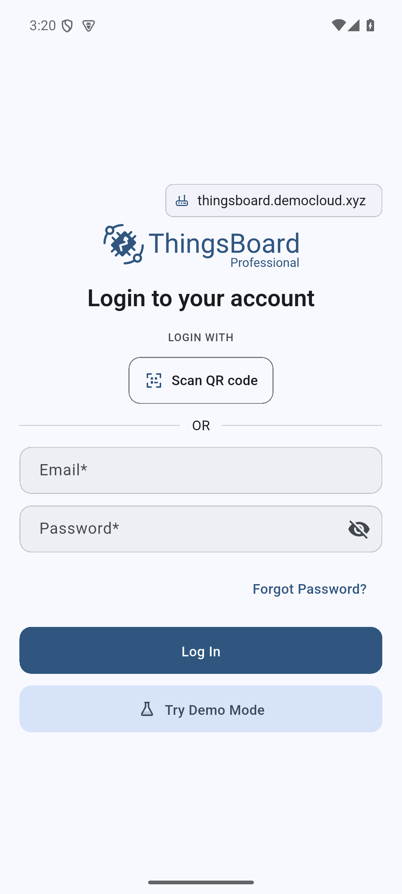
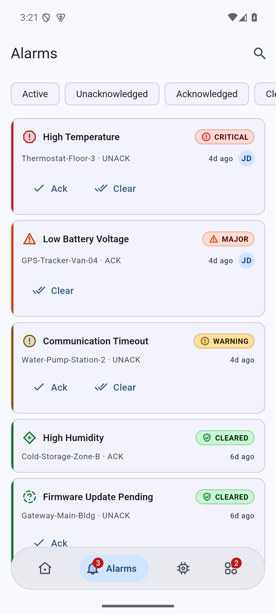
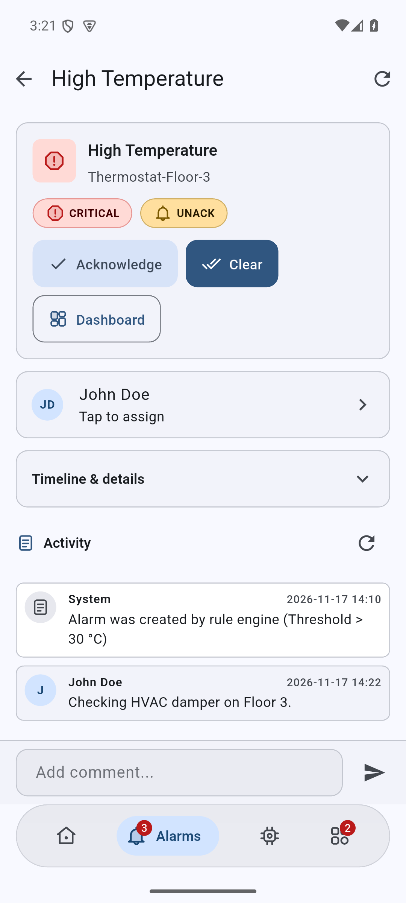
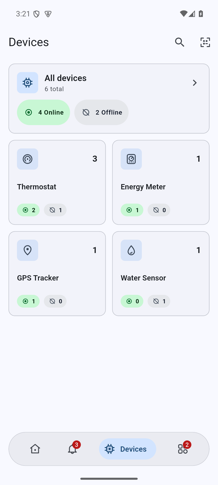
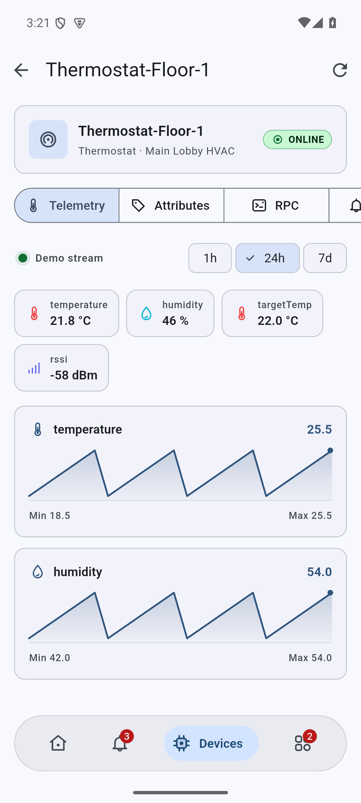
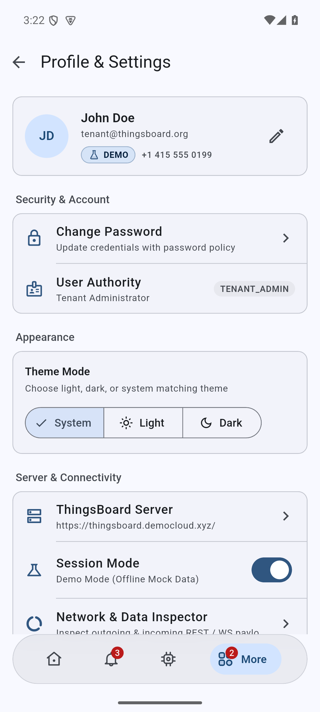
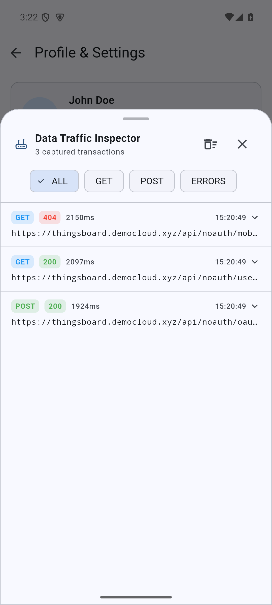
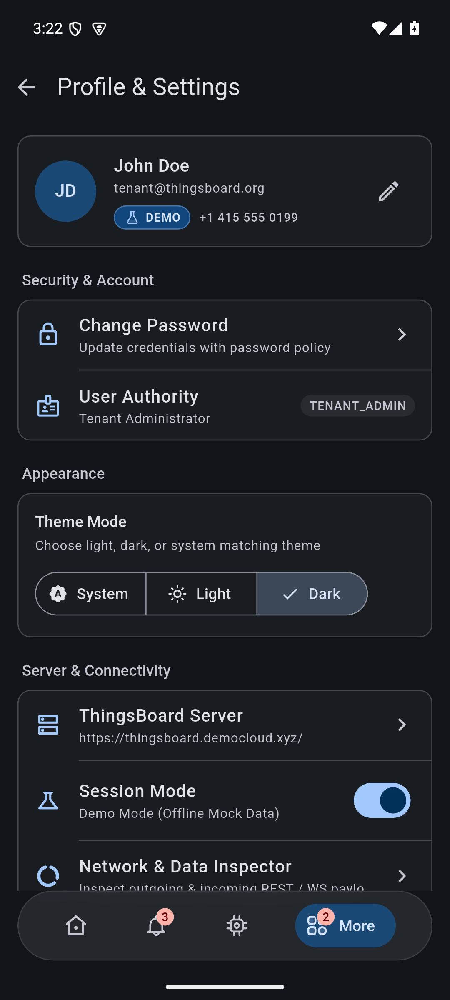
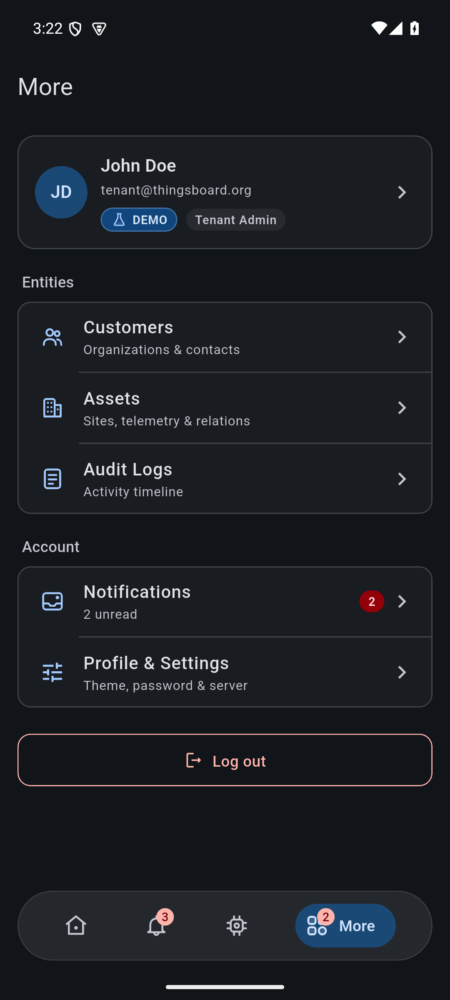
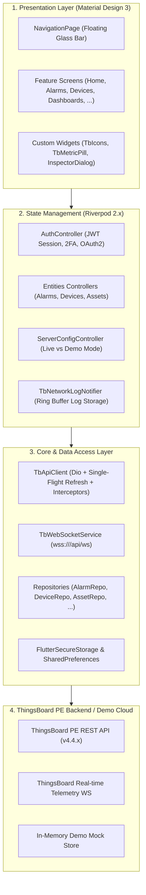

# ThingsBoard PE & DemoCloud Flutter Mobile Application

[](https://flutter.dev)
[](https://dart.dev)
[](https://m3.material.io/)
[](https://thingsboard.io/docs/pe/apis-and-sdks/)
[](test/)
[](lib/)

Ứng dụng di động **ThingsBoard Professional Edition (PE) / DemoCloud** được phát triển trên nền tảng **Flutter & Dart**, hỗ trợ đa nền tảng (Android & iOS). Ứng dụng cung cấp giao diện quản trị và giám sát IoT hiện đại theo chuẩn **Material Design 3**, triết lý thiết kế **tối giản chữ ("gọn gàng ít chữ nhất")**, thanh điều hướng **Glassmorphism xuyên thấu**, bộ nhận diện icon IoT riêng biệt, cùng công cụ giám sát gói tin mạng thời gian thực và chế độ Demo ngoại tuyến mượt mà.

---

## 📑 Mục Lục
1. [Điểm Nhấn Giao Diện & Tính Năng Vượt Trội](#1-điểm-nhấn-giao-diện--tính-năng-vượt-trội)
2. [Bộ Thư Viện Ảnh Thực Tế (Screenshots Gallery)](#2-bộ-thư-viện-ảnh-thực-tế-screenshots-gallery)
3. [Kiến Trúc Kỹ Thuật (Architecture & Tech Stack)](#3-kiến-trúc-kỹ-thuật-architecture--tech-stack)
4. [Cấu Trúc Thư Mục Dự Án (Project Structure)](#4-cấu-trúc-thư-mục-dự-án-project-structure)
5. [Tài Liệu Đối Chiếu API ThingsBoard PE (API Mapping)](#5-tài-liệu-đối-chiếu-api-thingsboard-pe-api-mapping)
6. [Công Cụ Giám Sát Dữ Liệu Mạng (Network & Data Inspector)](#6-công-cụ-giám-sát-dữ-liệu-mạng-network--data-inspector)
7. [Hướng Dẫn Cài Đặt & Vận Hành (Getting Started & Operations)](#7-hướng-dẫn-cài-đặt--vận-hành-getting-started--operations)
8. [Cài Đặt Trên Giả Lập Android / LDPlayer](#8-cài-đặt-trên-giả-lập-android--ldplayer)
9. [Kiểm Thử Chất Lượng & QA (Automated Testing)](#9-kiểm-thử-chất-lượng--qa-automated-testing)
10. [Quy Trình Git & Đồng Bộ Nhánh (Git Deployment Workflow)](#10-quy-trình-git--đồng-bộ-nhánh-git-deployment-workflow)

---

## 1. Điểm Nhấn Giao Diện & Tính Năng Vượt Trội

### 1.1. Thanh Điều Hướng Xuyên Thấu (Glassmorphism Floating Bar)
- **Thiết kế dạng viên thuốc nổi (`TbFloatingNavBar`):** Bo tròn hoàn toàn hai đầu (`StadiumBorder`, đúng ở mọi chiều cao), viền `outlineVariant`, tối đa `480dp` và căn giữa trên máy lớn/gập; lề `8dp` khi màn `< 360dp`.
- **Kính mờ vẫn đọc rõ:** `BackdropFilter` blur `16` + nền `surfaceContainerHigh` alpha `0.85` (token `navGlassOpacity`). Bật "độ tương phản cao" thì thanh chuyển sang đặc và tắt blur.
- **Nhãn trượt sang phải icon:** chạm icon → viên indicator (`primaryContainer`) trượt tới, nhãn trượt hiện **bên phải icon** và mờ dần ở tab cũ. Chuyển động chỉ dùng paint/transform (không relayout), tắt khi bật "giảm chuyển động", không lóe nhãn tab trung gian khi nhảy xa.
- **Màn hẹp:** khi không đủ chỗ cho 4 vùng chạm `48dp` + nhãn (ví dụ màn ngoài máy gập 280dp) nhãn được lược đi, vẫn còn tooltip và `Semantics`.
- **Cuộn bên dưới:** `Scaffold(extendBody: true)`, nội dung lướt dưới thanh; đệm đáy `DesignTokens.bottomNavClearance` (= chiều cao nav + khoảng hở + đệm) đảm bảo hàng cuối không bị che.

### 1.2. Hệ Thống Nhận Diện Icon Riêng Biệt (`TbIcons`)
- Bộ icon IoT vector chuyên biệt được xây dựng bằng `CustomPainter` và SVG nhị phân tối ưu GPU:
  - Icon phân hệ: Home, Alarms, Devices, Dashboards, Customers, Assets, Audit Logs, Notifications, Profile Settings.
  - Icon loại thiết bị: Sensor Node, Gateway, Smart Meter, Weather Station, Tracker, Actuator.
  - Icon mức độ nghiêm trọng cảnh báo: Critical, Major, Minor, Warning, Indeterminate, Cleared.
- Bao bọc bằng `RepaintBoundary` giúp giữ nguyên hiệu suất 60/120 FPS ngay cả khi danh sách cuộn nhanh.

### 1.3. Bảng Màu Ngữ Nghĩa Đo Lường IoT & Font Tabular
- Tự động nhận diện đơn vị và áp dụng màu sắc đặc trưng cho từng loại thông số viễn đo:
  - 🌡️ **Nhiệt độ (`°C`, `°F`, `K`):** Màu Coral Red (`#E05D44`)
  - 💧 **Độ ẩm (`%`, `%RH`):** Màu Aqua Cyan (`#00A896`)
  - ⚡ **Điện áp (`V`, `mV`, `kV`):** Màu Electric Amber (`#F4A261`)
  - 🔌 **Dòng điện (`A`, `mA`):** Màu Electric Violet (`#8338EC`)
  - 🔋 **Công suất (`W`, `kW`, `kWh`):** Màu Lime Energy (`#2A9D8F`)
  - 🌪️ **Áp suất (`bar`, `psi`, `kPa`):** Màu Deep Blue (`#264653`)
  - 🌊 **Lưu lượng (`L/min`, `m³/h`):** Màu Emerald Green (`#10B981`)
  - 📶 **Cường độ sóng (`dBm`):** Màu Indigo Wireless (`#6366F1`)
- Áp dụng `FontFeature.tabularFigures()` cho mọi con số để triệt tiêu hiện tượng rung lắc/nhảy giật layout khi số liệu thay đổi liên tục theo thời gian thực.

### 1.4. Tiện Ích Dán Link & Token Clipboard Nhanh
- Nút icon dán nhanh cạnh ô nhập Server URL tại trang đăng nhập: người dùng chỉ cần sao chép link máy chủ ThingsBoard từ tin nhắn hoặc email và nhấn 1 chạm để điền ngay.
- Nút `Paste link / code` tại trình quét mã QR: dán trực tiếp mã claim thiết bị hoặc link xác thực OAuth/QR khi chạy trên môi trường giả lập không có camera vật lý.

### 1.5. Chế Độ Demo / Offline Tức Thì (Instant Demo Mode)
- Trải nghiệm 100% chức năng ứng dụng (xem danh sách thiết bị, xác nhận/xóa cảnh báo, đồ thị sparkline, đổi theme, quản lý tài khoản) mà không cần có sẵn tài khoản server ThingsBoard hay kết nối internet.

---

## 2. Bộ Thư Viện Ảnh Thực Tế (Screenshots Gallery)

Toàn bộ ảnh chụp thực tế từ emulator Android (Pixel, API 35, 1080×2400), chụp lại ngày 2026-11-21 bằng `python -I scripts/capture_clean_screenshots.py` (tìm nút theo nhãn accessibility, kiểm PNG hợp lệ), lưu tại [docs/screenshots/](docs/screenshots/):

| 01. Đăng Nhập & Dán Link | 02. Trang Chủ & Navigation Bar Nổi | 03. Quản Lý Cảnh Báo IoT |
|:---:|:---:|:---:|
| [](docs/screenshots/01_login_page.png) | [](docs/screenshots/02_home_page.png) | [](docs/screenshots/03_alarms_page.png) |
| *Đăng nhập, dán link & Demo mode* | *Nav viên thuốc kính mờ, nhãn trượt sang phải icon & Metric pills* | *Cảnh báo phân cấp màu & icon severity* |

| 04. Chi Tiết Cảnh Báo & 1-Tap | 05. Danh Mục Thiết Bị Profile | 06. Chi Tiết Thiết Bị & Telemetry |
|:---:|:---:|:---:|
| [](docs/screenshots/04_alarm_details_page.png) | [](docs/screenshots/05_devices_page.png) | [](docs/screenshots/06_device_details_page.png) |
| *Xác nhận cảnh báo & phân công 1 chạm* | *Thống kê Active/Inactive theo profile* | *Đồ thị Telemetry & Điều khiển RPC* |

| 07. Menu Mở Rộng Phân Hệ | 08. Cài Đặt Tài Khoản & Mạng | 11. Trình Giám Sát Gói Tin Mạng |
|:---:|:---:|:---:|
| [](docs/screenshots/07_more_page.png) | [](docs/screenshots/08_profile_settings.png) | [](docs/screenshots/11_network_inspector.png) |
| *Assets, Customers, Audit Logs, Thông báo* | *Cấu hình giao diện & Network Inspector* | *Soi Request/Response Body, Header, Latency* |

| 09. Chế Độ Dark Theme Profile | 10. Chế Độ Dark Theme More Menu |
|:---:|:---:|
| [](docs/screenshots/09_dark_theme_profile.png) | [](docs/screenshots/10_dark_theme_more.png) |
| *Giao diện tối sang trọng, tương phản cao* | *Menu mở rộng trong chế độ Dark Theme* |

---

## 3. Kiến Trúc Kỹ Thuật (Architecture & Tech Stack)

Ứng dụng tuân thủ kiến trúc nhiều lớp rõ ràng (Layered Clean Architecture), phân tách độc lập giữa Presentation, Business Logic, và Data Access:



- **Quản lý trạng thái:** `hooks_riverpod` kết hợp `Notifier` & `AsyncNotifier` đảm bảo state luôn bất biến (immutable), an toàn tuyệt đối trước các cuộc đua cập nhật (race condition).
- **Điều hướng & Định tuyến:** `go_router` với `StatefulShellRoute.indexedStack` bảo toàn trạng thái cuộn của từng tab, tích hợp Auth Redirect Guard tự động kiểm soát phiên đăng nhập.
- **Tầng mạng & API:** `dio` được bọc qua `TbApiClient`, tích hợp single-flight token refresh tự động gia hạn JWT, chuyển đổi baseUrl linh hoạt và tự động xử lý fallback khi endpoint trả về `404`.
- **Kênh dữ liệu thời gian thực:** `TbWebSocketService` quản lý một kết nối WebSocket duy nhất, tự động multiplex các subscription theo `cmdId`, gửi heartbeat ping mỗi 30 giây và tự động khôi phục luồng dữ liệu khi kết nối mạng phục hồi.

---

## 4. Cấu Trúc Thư Mục Dự Án (Project Structure)

```text
thingboard-mobileapp/
├── lib/
│   ├── config/                     # Cấu hình routes, Material 3 theme & Design Tokens
│   │   ├── routes/                 # Router, Auth Guard, route paths
│   │   └── themes/                 # M3 Light/Dark color schemes, typography, spacing
│   ├── constants/                  # Hằng số hệ thống, endpoint mặc định
│   ├── core/
│   │   ├── api/
│   │   │   ├── client/             # TbApiClient, Network Inspector, Interceptors
│   │   │   ├── controllers/        # Riverpod Notifiers (Auth, Alarms, Devices, Telemetry, ...)
│   │   │   ├── repositories/       # REST API repositories kèm cơ chế Fallback
│   │   │   └── ws/                 # Dịch vụ WebSocket Telemetry & Notifications
│   │   ├── auth/                   # Màn hình Đăng nhập, 2FA, Reset Password, QR Scanner
│   │   ├── mock/                   # Bộ dữ liệu mẫu Demo Mode đầy đủ quan hệ
│   │   └── models/                 # Mô hình dữ liệu chuẩn hóa, JSON parsing bất biến
│   ├── modules/                    # Các phân hệ giao diện chính
│   │   ├── alarm/                  # Danh sách và chi tiết cảnh báo
│   │   ├── asset/                  # Quản lý tài sản (Assets)
│   │   ├── audit_log/              # Nhật ký kiểm toán (Audit Logs)
│   │   ├── customer/               # Quản lý khách hàng (Customers)
│   │   ├── dashboard/              # Danh sách & xem chi tiết Dashboard
│   │   ├── device/                 # Danh sách & chi tiết thiết bị, RPC control
│   │   ├── home/                   # Trang chủ Dashboard KPI Strip
│   │   ├── main/                   # Shell NavigationPage (Thanh kính mờ nổi)
│   │   ├── more/                   # Menu mở rộng các phân hệ
│   │   ├── notification/           # Trung tâm thông báo & cài đặt nhận tin
│   │   └── profile/                # Cài đặt tài khoản & mở Network Inspector
│   ├── utils/                      # Tiện ích UI, format thời gian, barcode scanner
│   ├── widgets/                    # Shared components: TbIcons, TbMetricPill, InspectorDialog
│   └── main.dart                   # Điểm khởi động ứng dụng
├── test/                           # 32 file kiểm thử tự động (Unit + Widget Tests)
├── docs/
│   ├── ai/                         # Tài liệu kiến trúc, UI rules, API rules
│   └── screenshots/                # Toàn bộ 11 ảnh chụp màn hình PNG thực tế
└── scripts/                        # Các script Python tự động hóa build & capture ảnh
    ├── capture_clean_screenshots.py
    └── smart_capture.py
```

---

## 5. Tài Liệu Đối Chiếu API ThingsBoard PE (API Mapping)

Toàn bộ 13 nhóm API chính thức theo [ThingsBoard PE Documentation](https://thingsboard.io/docs/pe/apis-and-sdks/) đã được xây dựng, kiểm thử và chuẩn hóa cơ chế dự phòng:

| Nhóm API | Endpoints REST / WebSocket Gốc | Trạng Thái | Cơ Chế Dự Phòng & Tối Ưu |
|---|---|:---:|---|
| **1. Authentication** | `POST /api/auth/login`<br>`POST /api/auth/token`<br>`POST /api/auth/logout`<br>`GET /api/auth/user` | ✅ Hoàn thành | Header `X-Authorization: Bearer <jwt>`. Tự động refresh token single-flight chống race condition. Chuyển mượt sang `SessionMode.demo` khi offline. |
| **2. 2FA & Mật Khẩu** | `POST /api/auth/2fa/verification/check`<br>`POST /api/noauth/resetPasswordByEmail`<br>`POST /api/auth/changePassword` | ✅ Hoàn thành | Hỗ trợ xác thực 2 bước (TOTP/SMS/Email). Tự động cập nhật cặp JWT mới vào bộ nhớ an toàn ngay sau khi đổi mật khẩu. |
| **3. Cấu Hình Máy Chủ** | `GET /api/noauth/userPasswordPolicy`<br>`POST /api/noauth/oauth2Clients`<br>`GET /api/noauth/mobile` | ✅ Hoàn thành | Hỗ trợ cả Query Parameters và JSON Request Body cho OAuth2 client discovery. Fallback an toàn khi endpoint thiếu. |
| **4. Quản Lý Cảnh Báo** | `GET /api/v2/alarms`<br>`POST /api/alarm/{id}/ack`<br>`POST /api/alarm/{id}/clear`<br>`POST /api/alarm/{id}/assign/{userId}`<br>`GET,POST /api/alarm/{id}/comment` | ✅ Hoàn thành | Thao tác 1 chạm (Ack, Clear, Assign, Thêm ghi chú). Tự động cập nhật giao diện lập tức không cần tải lại toàn bộ trang. |
| **5. Thiết Bị & Hồ Sơ** | `GET /api/deviceProfileInfos`<br>`POST /api/entitiesQuery/count`<br>`GET /api/deviceInfos/all`<br>`POST /api/customer/device/{name}/claim` | ✅ Hoàn thành | **Cơ chế Fallback:** Tự động chuyển từ `/api/deviceInfos/all` sang `/api/tenant/deviceInfos` khi bị giới hạn quyền hoặc gặp mã `404`. |
| **6. Dashboards** | `GET /api/dashboards/all`<br>`GET /api/dashboard/{id}`<br>`GET /api/dashboard/{id}/info` | ✅ Hoàn thành | Danh sách yêu thích, hiển thị nhúng responsive 2-pane trên màn hình lớn. Fallback sang `/api/tenant/dashboards`. |
| **7. Viễn Đo Telemetry** | `GET /api/plugins/telemetry/{type}/{id}/values/timeseries`<br>`GET /.../timeseries/history`<br>`GET,POST /.../attributes/{scope}` | ✅ Hoàn thành | Biểu đồ sparklines thời gian thực. Hỗ trợ fallback sang dải thời gian truyền thống (`?startTs=...&endTs=...`) nếu server đời cũ. |
| **8. Điều Khiển RPC** | `POST /api/rpc/oneway/{deviceId}`<br>`POST /api/rpc/twoway/{deviceId}` | ✅ Hoàn thành | Gửi lệnh điều khiển hai chiều (Two-way RPC), bắt lỗi timeout (504) và hiển thị kết quả phản hồi dạng JSON trực quan. |
| **9. Quản Lý Tài Sản** | `GET /api/assetProfileInfos`<br>`GET /api/assetInfos/all`<br>`GET /api/relations` | ✅ Hoàn thành | **Cơ chế Fallback:** Tự động chuyển sang `/api/tenant/assetInfos` khi gặp `404`. Hiển thị quan hệ tài sản - thiết bị. |
| **10. Khách Hàng** | `GET /api/customerInfos/all`<br>`GET /api/customer/{id}` | ✅ Hoàn thành | Quản lý danh sách khách hàng và các tài nguyên được gán cho từng đối tượng khách hàng. |
| **11. Nhật Ký Kiểm Toán** | `GET /api/audit/logs`<br>`GET /api/audit/logs/entity/{type}/{id}` | ✅ Hoàn thành | Truy vết toàn bộ nhật ký thay đổi của hệ thống theo 4 phạm vi (Tenant, Entity, User, Customer). |
| **12. Thông Báo** | `GET /api/notifications`<br>`GET /api/notifications/unread/count`<br>`PUT /api/notification/{id}/read`<br>`PUT /api/notification/settings` | ✅ Hoàn thành | Hộp thư thông báo unread, đánh dấu đã đọc một/tất cả, cấu hình kênh nhận tin và đăng ký FCM mobile token. |
| **13. Real-time WS** | `wss://<host>/api/ws`<br>`ENTITY_DATA`, `LATEST_TELEMETRY`<br>`TIMESERIES`, `NOTIFICATIONS_COUNT` | ✅ Hoàn thành | Kênh WebSocket tập trung, tự động reconnect với JWT mới nhất, phục hồi toàn bộ active subscriptions khi có mạng. |

---

## 6. Công Cụ Giám Sát Dữ Liệu Mạng (Network & Data Inspector)

Ứng dụng tích hợp sẵn công cụ chẩn đoán dữ liệu chuyên sâu cho tester và lập trình viên:

- **Vị trí truy cập:** Mở ứng dụng -> Tab **More** -> **Profile & Settings** -> Chọn mục **"Network & Data Inspector"**.
- **Tính năng nổi bật:**
  - **Giám sát hai chiều:** Ghi nhận cả yêu cầu gửi đi (Request) và dữ liệu nhận về (Response) theo thời gian thực.
  - **Đo lường độ trễ (Latency):** Tính toán chính xác thời gian phản hồi theo milliseconds (ví dụ: `45ms`, `120ms`).
  - **Bộ lọc thông minh:** Lọc nhanh theo `ALL`, `GET`, `POST`, hoặc các gói tin gặp lỗi `ERRORS`.
  - **Định dạng JSON chuẩn:** Hiển thị dữ liệu thụt lề rõ ràng, dễ đọc.
  - **Bảo mật tuyệt đối:** Tự động che dấu các header xác thực (`X-Authorization: Bearer ***`) và thông tin nhạy cảm.
  - **Nút sao chép 1 chạm:** Cho phép copy nhanh toàn bộ payload hoặc URL để gửi báo cáo lỗi.

---

## 7. Hướng Dẫn Cài Đặt & Vận Hành (Getting Started & Operations)

### 7.1. Yêu Cầu Môi Trường
- **Flutter SDK:** Phiên bản `>= 3.29.0` (Khuyến nghị `3.50.0 stable`)
- **Dart SDK:** Phiên bản `^3.7.0` (Khuyến nghị `3.14.0+`)
- **Java Development Kit (JDK):** JDK 17 hoặc JDK 21
- **Android Studio / Android SDK:** Hỗ trợ API Level 34 & 35
- **Thiết bị:** Thiết bị Android thật, Android Virtual Device (AVD), hoặc LDPlayer

### 7.2. Các Lệnh Thao Tác Cơ Bản

```bash
# 1. Cài đặt các thư viện phụ thuộc
flutter pub get

# 2. Kiểm tra chất lượng mã nguồn (Yêu cầu: 0 issue, kể cả mức info)
flutter analyze --fatal-infos

# 3. Chạy toàn bộ test (khoảng 1150 test, ~2 phút) kèm coverage
flutter test --coverage

# 4. Định dạng toàn bộ mã nguồn theo chuẩn Dart
dart format .

# 4b. Chạy tất cả cổng CI ở máy (format, analyze, test, ngưỡng coverage)
powershell -ExecutionPolicy Bypass -File tools/qa/run_checks.ps1

# 5. Khởi chạy ứng dụng trên thiết bị đang kết nối
flutter run

# 6. Đóng gói ứng dụng Android Debug APK
flutter build apk --debug
```

File APK hoàn chỉnh sẽ được tạo tại: `build/app/outputs/flutter-apk/app-debug.apk`.

---

## 8. Cài Đặt Trên Giả Lập Android / LDPlayer

### 8.1. Cài Đặt Vào Thiết Bị Đang Chạy
Khi bạn đã mở LDPlayer hoặc Android Virtual Device:

```bash
# Kiểm tra danh sách thiết bị ADB đã nhận
adb devices

# Nếu dùng LDPlayer, kết nối tới cổng ADB mặc định:
adb connect 127.0.0.1:5555

# Cài đặt file APK vừa build vào giả lập
adb install -r build/app/outputs/flutter-apk/app-debug.apk

# Khởi chạy ứng dụng trực tiếp
adb shell am start -n com.example.thingsboard_democloud_app/.MainActivity
```

### 8.2. Chạy Script Chụp Ảnh Tự Động Hóa
Dự án cung cấp script Python thông minh tự động mở app, điều hướng qua tất cả các màn hình và chụp ảnh nhị phân nguyên vẹn:

```bash
python scripts/smart_capture.py
```

Ảnh chụp sẽ được lưu tự động tại `docs/screenshots/` và có thể mở xem trực tiếp bằng trình xem ảnh gốc **Windows Photo Viewer**.

---

## 9. Kiểm Thử Chất Lượng & QA (Automated Testing)

Dự án áp dụng Test-Driven Development (test đỏ → sửa → xanh) và chặn lỗi tự động bằng CI (`.github/workflows/ci.yml`).

```bash
flutter test --coverage
```

### Kết Quả Kiểm Thử Thực Tế (2026-11-21):
```text
01:25 +1156: All tests passed!
lib/ 87.6% · lib/core/api 89.1% · lib/widgets 98.3%   (ngưỡng CI: 80%)
```
- **Hợp đồng API (offline):** mọi request của 12 repository được xác thực với ThingsBoard REST API 4.4.1PAAS (path, method, tham số bắt buộc/enum, body). Xem [docs/qa/API_CONTRACT.md](docs/qa/API_CONTRACT.md) và [báo cáo kiểm toán](docs/qa/audit-2026-11-21-api.md).
- **Router, Controller, WebSocket:** single-flight token refresh, ánh xạ `ThingsboardErrorCode`, phân trang, loại bỏ phản hồi cũ (stale), hủy đăng ký WS khi đóng màn hình.
- **Độ bền UI:** 12 màn × payload thưa/rỗng/null/Unicode/403/500/mất mạng × sáng/tối × chữ 1.0x/2.0x; ma trận 15 màn × 10 cỡ máy (từ màn gập 280dp đến tablet, có màn ngang).
- **Thanh điều hướng:** toán bố cục, chuyển động, giảm chuyển động, độ tương phản cao, vùng chạm `>= 48dp`, 13 cỡ máy × 2 cỡ chữ.
- **Bảo mật:** Network Inspector che mật khẩu, token, OTP, secret QR (xem `TbNetworkRedactor`).
- **QA thủ công:** [docs/qa/QA_CHECKLIST.md](docs/qa/QA_CHECKLIST.md) cho thiết bị thật trước mỗi release.

---

## 10. Quy Trình Git & Đồng Bộ Nhánh (Git Deployment Workflow)

Dự án quản lý các nhánh phát triển chuẩn mực. Để cập nhật toàn bộ tính năng mới từ nhánh làm việc lên nhánh `main` và `master`, thực hiện theo các bước sau:

```bash
# 1. Đảm bảo nhánh hiện tại đã commit sạch sẽ
git status

# 2. Đẩy nhánh làm việc lên remote
git push origin dmhoang

# 3. Đồng bộ và đẩy thẳng lên nhánh main
git checkout main
git merge dmhoang --ff-only
git push origin main

# 4. Đồng bộ và đẩy thẳng lên nhánh master
git checkout master
git merge dmhoang --ff-only
git push origin master

# 5. Quay trở lại nhánh làm việc
git checkout dmhoang
```

---

## 📄 Bản Quyền & Giấy Phép
Dự án được phát triển phục vụ kết nối hệ thống **ThingsBoard Professional Edition (PE) & DemoCloud**. Mọi quyền được bảo lưu.
